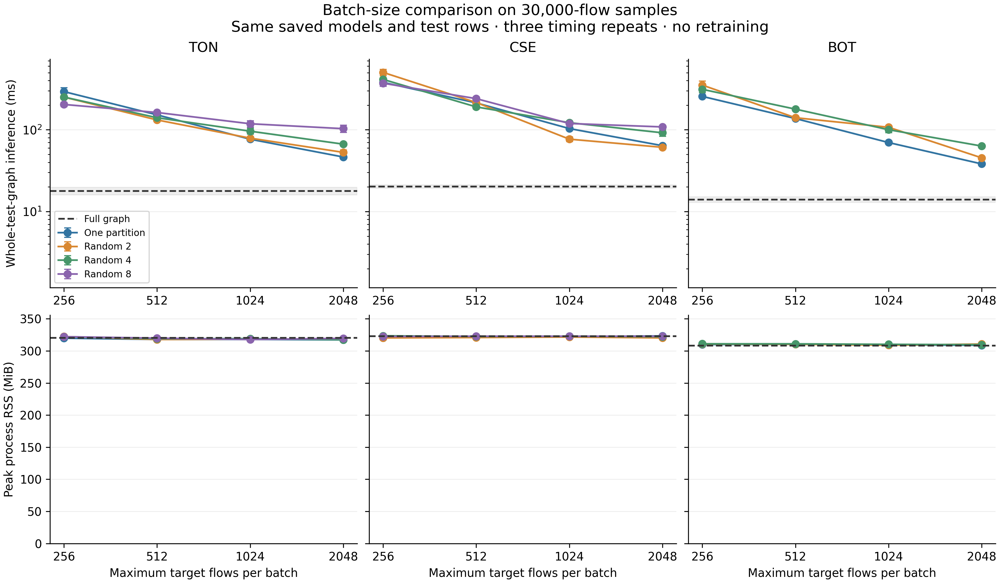

# Batch size and partition count

This study separates the cost of small batches from the cost of partitioning. It reuses the binary models and test graphs from the 30,000-flow uniform pilots. The models, split rules, features, labels, test rows and partition seeds remain fixed. No model is trained or tuned in this study.

## Protocol

The planned conditions were written to each run's `study_plan.json` before execution. The batch limits are 256, 512, 1,024 and 2,048 target flows. The comparison includes one full-graph forward pass, one partition with small batches, and Random/METIS partition counts of 2, 4 and 8. Full is measured once per dataset, with its batch cap ignored. The order of conditions is shuffled with seed 20261019.

Each valid condition runs in a fresh process, loads the same saved model, completes one full warm-up pass, and then measures three complete inference passes. The graph uses the new read-only mapped array format in every condition. All probabilities are checked against the saved reference and must agree within 1e-5 absolute and relative tolerance. Predicted classes must be identical. Every target must be scored exactly once. Node ownership is also checked across batch sizes.

The main time is the whole-test-graph inference loop: batch packing, transfers, model calls and result collection. It excludes the original CSV preparation, graph construction, conversion to mapped arrays, graph/checkpoint loading, partitioning, warm-up and process startup. Those boundaries are explicit in the manifests. This is warm inference timing, not end-to-end online detection latency.

Memory is process RSS sampled every 5 ms. It includes the resident input graph and model; caches left by warm-up can remain. The reported maximum is the highest sampled RSS across the three timing repeats. Other application processes and the parent process are outside this measurement. These workstation measurements do not imply a deployment-wide memory bound.

## Evidence

All three sweeps are complete: **47 conditions ran, with 141 timing records**. A further 40 planned conditions were recorded as unavailable or infeasible. Every completed condition kept the same predicted classes and scored each test target once. The largest probability difference from the saved reference was 1.19e-7, below the stated tolerance. Node assignments were unchanged across batch sizes.

| Dataset | Test flows | Full graph (ms) | One partition, batch 256 (ms) | One partition, batch 2,048 (ms) |
|---|---:|---:|---:|---:|
| ToN | 6,197 | 17.852 | 292.949 | 46.436 |
| CSE | 6,592 | 20.186 | 379.987 | 63.890 |
| BoT | 7,875 | 14.019 | 255.991 | 38.231 |

These are means of three warm timing repeats for one model. The full graph was fastest among the completed conditions on each dataset. Increasing the one-partition batch from 256 to 2,048 reduced total inference time by about six times. The sampled process RSS showed no consistent material benefit from partitioning on these small graphs. This supports a batching-cost explanation, not a claim that partitioning is faster.

Aggregate results and prediction checks are in `artifacts/batch-study/`. The combined CSV and LaTeX tables retain every successful condition. Infeasible and unavailable conditions stay in separate JSON records. The figure shows the mean and standard deviation of three timing repeats for the same model; these are not independent model seeds or confidence intervals for generalization.



The BoT test graph has four original IP nodes, so eight node partitions are infeasible. Real-data METIS remains unavailable in this Windows environment. The Linux tests verify the software path on artificial data; they are not real-data METIS measurements.

The benchmark code passed all 31 local tests and the [Linux checks at commit 5e9325f](https://github.com/MahsaRz/CA-EdgeIDS/actions/runs/39296446848). These timings use mapped storage and one complete warm-up pass, so they must not be mixed with earlier pilot timings as if the measurement protocols were identical.

## Interpretation

The full-graph and one-partition controls are necessary. Smaller per-batch times alone do not show that all test flows finish sooner. Both total work and the complete inference loop matter. Any benefit from a larger batch must be separated from the choice of graph partitioner.

These are small binary pilots with one saved model per dataset and an initial untuned architecture. They do not complete the planned five-seed study, establish superior classification accuracy, resolve the multiclass split problem, or show distributed scaling. The next scaling study should increase workload independently of the batch and partition settings and retain out-of-memory and unavailable outcomes.

## Reproduction

```text
python -m ca_edgeids batch-study --run-dir runs/ton-binary-scaling-30000 --out runs/ton-batch-study
python scripts/report_batch_study.py --export runs/ton-batch-study artifacts/batch-study/ton
python scripts/report_batch_study.py
```

Repeat the run/export step for CSE and BoT before rebuilding the combined figure. Raw flows, model files, node assignments and per-flow probabilities stay local. The published bundle contains only aggregate timings, hashes, checks and plots.
