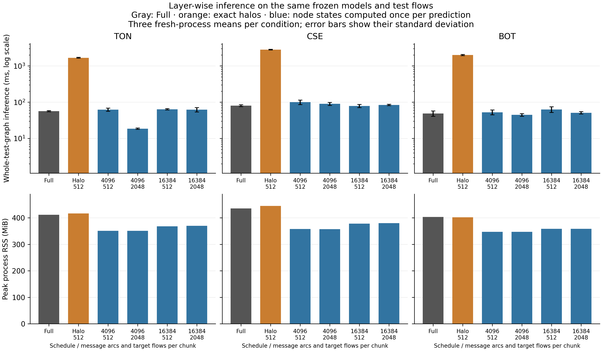

# Layer-wise inference comparison

## Purpose and scope

The earlier exact-halo pilot recomputes message passing for every target batch. This comparison computes each node layer once for a complete snapshot, then decodes target flows in chunks. Message tensors are also chunked. Each message arc is visited once per layer, regardless of the number of target batches. This is an implementation control for the existing model, with no claim of a new GNN algorithm or distributed execution.

All node states for a layer remain resident. The input graph is still present, output probabilities are retained, and message chunks have temporary activations. A working-tensor estimate screens oversized configurations; it is not a bound on total memory. This approach does not establish that a million-node graph fits this workstation.

Node states are recomputed on every prediction call, including every timing repeat. No representation is carried over from warm-up, another graph snapshot, or another model. Dropout is disabled in evaluation, just as in the Full reference. Training and saved checkpoints are unchanged.

## Computation and storage

Let N be the number of IP nodes, M the number of directed message arcs, E the number of original target flows, d the transformed flow-feature width, h the hidden width, L the layer count and C the number of classes. Reverse arcs contribute to M, not to E. The initial node width is two; subsequent layers use h.

For the implemented linear message/update functions, message arithmetic at layer l is proportional to `M * (w_previous + d) * h`; node updates cost `N * (w_previous + h) * h`. The edge decoder costs `E * ((2h + d) * h + h * C)`. Sum the layer terms over L. With fixed widths/depth, this model arithmetic is linear in node, arc and target counts. Standard full-graph message passing has no exponential graph-size term. Input packing, sorting, transfer and filesystem operations add costs outside this arithmetic expression and remain inside the relevant measured timer.

The old exact-halo schedule replaces each layer's M with the sum of the arc counts packed across target batches. That sum can greatly exceed M. The layer-wise path visits exactly M arcs at each layer and retains O(Nh) node-state/aggregation storage, with temporary message and decoder storage depending on the two chunk limits. Original graph arrays, transformed flow features, O(EC) output probabilities, coverage arrays, model parameters and allocator overhead remain additional. This is a reduction in repeated arithmetic and temporary tensor size, not a guarantee on total RAM or an out-of-core node-state algorithm.

## Frozen comparison

Use the three saved seed-7 binary models from the 100,000-flow Linux pilot and their original test graphs and row IDs. There is no retraining, hyperparameter selection or test-label input. Freeze the code and execution order before measuring:

- One Full control and one one-partition exact-halo control with target batch size 512.
- Four layer-wise conditions: message chunks of 4,096 or 16,384 arcs crossed with target chunks of 512 or 2,048 flows.
- Three datasets, giving 18 conditions; one fresh worker per condition, one complete warm-up prediction and three complete timed predictions.
- Shuffled execution order with seed 20261020; CPU, one PyTorch thread, the same local Ubuntu/WSL2 environment.
- Exactly-once test coverage, identical class predictions and probabilities within absolute/relative tolerance 1e-5 of the original saved Full reference.
- Warm time includes all encoding, decoding, transfers and output collection. Process launch through first prediction is separate and has one observation per condition. Neither timer includes original source preparation or graph construction. File caches need not be cold.
- Retain failures and avoid selecting a winning chunk size as a tuned final configuration. These are fixed-model systems measurements, not independent trained seeds or final journal evidence.

Run `python scripts/run_cached_study.py` in the prepared Linux environment. Private outputs go to `runs/cached-inference-100000/`; source, graph-array, checkpoint and reference hashes accompany the plan. The correctness tests compare against Full at depths 1-3 in both graph directions, test self-loops, parallel flows and isolated nodes, check actual message-module visits, and ensure graph/model changes recompute the states. Cached inference does not read graph labels.

## Confirmation protocol

The first 18-condition run completed with zero probability differences. One ToN chunk setting was unusually fast relative to the other settings, so a second stage repeats the full matrix in three new independent process blocks before interpreting speed differences. Keep the first run as exploratory evidence; do not combine it selectively with confirmation results.

The confirmation blocks use the same six conditions per dataset, three warm timing repeats per fresh worker, unchanged numerical code/checkpoints, and fixed order seeds 20261021, 20261022 and 20261023. Output roots are `runs/cached-confirmation-100000/block-1` through `block-3`. Report each process mean, then aggregate across the three process means. These are independent process starts for one trained model per dataset, not additional model seeds. Retain all settings and failures. Each process still recomputes node states for every prediction.


## Verified confirmation results

All **54 confirmation process conditions and 162 warm timing measurements** completed, with no failures. Every condition preserves exactly-once test coverage and identical class predictions. The maximum probability difference from the original saved Full reference is 0. The exploratory 18-process/54-timing run remains in a separate bundle and is excluded from the confirmation averages.

The numerical implementation passed the 41-test Linux workflow at `d8c10e5`. This includes eight new layer-wise tests. Confirmation sources are frozen at `60645d3`; all three blocks use identical numerical sources, graph arrays, checkpoint hashes and target-row hashes. No training or classifier-quality result changed.

The table reports complete warm inference in **milliseconds**, as the mean and sample standard deviation across three fresh-process means. Each process mean first averages its three timing repeats. The error bars measure process timing variation for one saved model, not uncertainty across training seeds.

| Dataset | Full | Halo, target 512 | Layer-wise 4096/512 | Layer-wise 4096/2048 | Layer-wise 16384/512 | Layer-wise 16384/2048 |
|---|---:|---:|---:|---:|---:|---:|
| TON | 56.38 ± 2.12 | 1676.22 ± 46.49 | 62.19 ± 5.96 | 18.61 ± 0.80 | 63.67 ± 2.61 | 62.30 ± 8.62 |
| CSE | 80.03 ± 4.64 | 2814.84 ± 52.86 | 99.85 ± 14.57 | 89.97 ± 8.63 | 78.71 ± 7.87 | 83.82 ± 3.17 |
| BOT | 49.01 ± 8.38 | 1991.03 ± 81.91 | 52.71 ± 8.11 | 44.58 ± 3.74 | 63.25 ± 11.00 | 50.91 ± 3.77 |

For layer-wise column labels, the first number is message arcs per chunk and the second is target flows per decoder chunk. All four settings were fixed before the first comparison and are retained; none is presented as a tuned universal winner.

The layer-wise implementation removes the large overhead of the old target-batch halo schedule. Its comparison with Full depends on dataset and chunk settings. The ToN 4096/2048 setting retains its lower measured time across the three confirmation starts, while several other settings are slower than Full. A general cluster-partitioning speed claim is still unsupported: this implementation uses global node states and no partition ownership. It provides an additional necessary baseline for any later cluster-specific claim.

| Dataset | Full peak RSS, MiB | Halo-512 peak RSS, MiB | Layer-wise peak RSS range across settings, MiB |
|---|---:|---:|---:|
| TON | 411.5 | 416.5 | 351.1–369.5 |
| CSE | 435.6 | 444.9 | 357.1–379.8 |
| BOT | 403.2 | 402.2 | 346.9–358.2 |

Peak values use the maximum sampled process RSS across the repeats/processes, not an exact allocation bound. Layer-wise inference uses less sampled RSS than both controls in these measurements. All node states still remain resident and the largest test graph has only 3,971 IP nodes; this does not establish large-topology memory scaling.



The [confirmation bundle](../artifacts/cached-confirmation-100000/) includes all process means, raw aggregate timing rows, startup/loading components, source/input hashes and per-block verification. The [exploratory bundle](../artifacts/cached-inference-100000/) remains separate. Raw graph arrays, model checkpoints and per-flow predictions are excluded from both.

## Reproduction and next gate

After reproducing the earlier saved models and graphs, run these commands in the recorded Linux environment:

```text
python scripts/run_cached_study.py --out runs/cached-confirmation-100000/block-1 --order-seed 20261021
python scripts/run_cached_study.py --out runs/cached-confirmation-100000/block-2 --order-seed 20261022
python scripts/run_cached_study.py --out runs/cached-confirmation-100000/block-3 --order-seed 20261023
python scripts/report_cached_confirmation.py
```

Run directories and public bundles refuse to overwrite earlier evidence. For the initial exploratory run, use the defaults of `run_cached_study.py` followed by `report_cached_study.py`.

The repeated-computation issue now has a tested alternative. The next research gate is matched classifier/graph baselines and validation-only model development, followed by independent model seeds and larger controlled workloads. Keep Full and this global layer-wise baseline in future comparisons; accuracy, speed and memory must all use unchanged targets and declared budgets. ToN false positives, BoT minority-class performance and multiclass split feasibility remain unresolved. No manuscript, causal, distributed or unseen-topology claim follows from this inference change. Overleaf remains unchanged.
