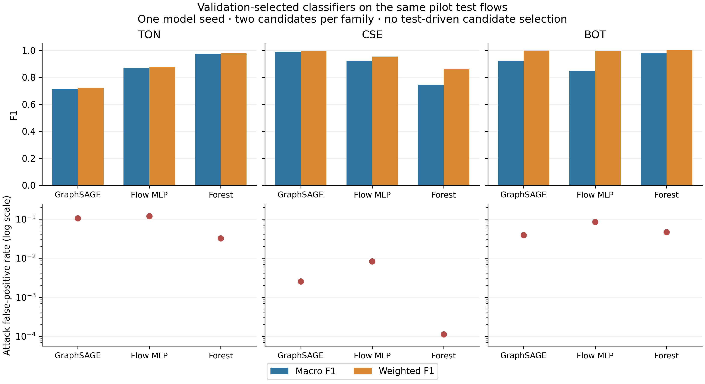
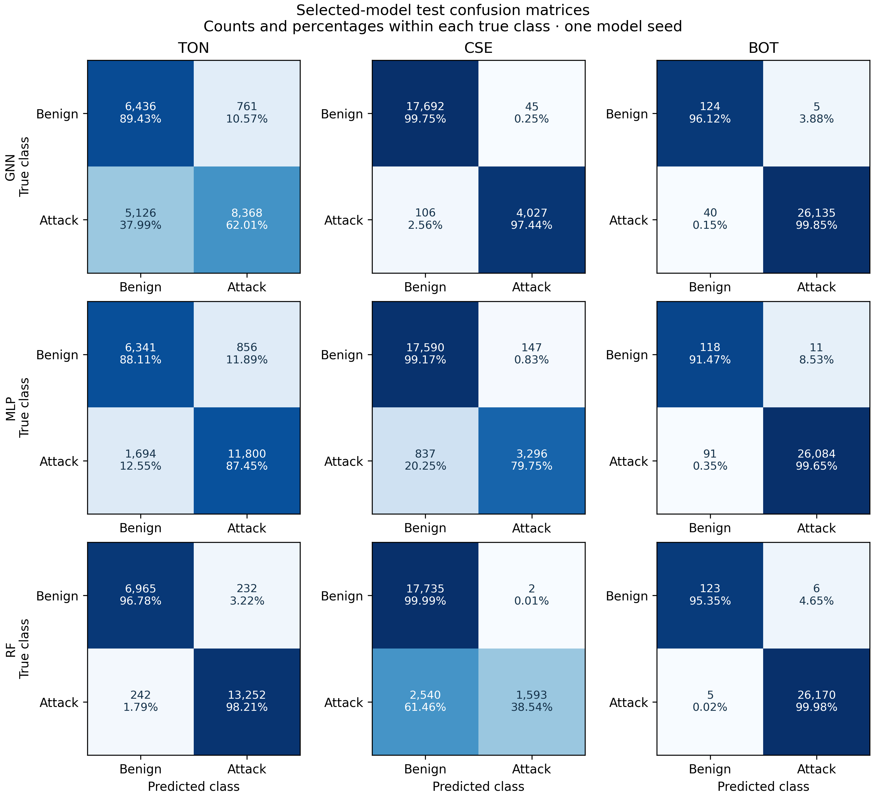

# Validation-selected classifier comparison

This is a single-seed development study on the existing 100,000-flow samples, whose test results have already been inspected during earlier pilots. It cannot be described as an untouched final evaluation. Keep the same original flow identities, features, train-fitted preprocessing and host-pair splits. This stage compares prediction quality; inference timers in its shared process are diagnostic and must not become a systems benchmark.

## Frozen selection budget

The plan is `configs/classifier_comparison_100000.json`. Each of GraphSAGE, a flow-only MLP and Random Forest receives two predefined candidates. Both neural candidates use learning rates 0.001/0.003; the forests use maximum depth 16/unrestricted with 100 trees each. There is one initialization seed, 7. Candidate selection and checkpoint selection use validation macro F1 only; exact ties choose the first declared candidate. Prediction uses fixed argmax with no threshold search.

The neural models share hidden width 16, dropout 0.2, Adam weight decay 0.0001, maximum 10 epochs, patience 3, gradient clipping 5 and the same training-class-balanced cross entropy. They use identical training target batches, formed by the original random source ownership, with at most 512 targets per batch. Both use the same seed-7 sequence of batch shuffles across epochs. GraphSAGE has two message layers and an edge decoder; the MLP has two hidden layers and receives the same transformed flow features without graph context or degree features. Their parameter counts differ and are reported.

The original learning-rate-0.001 GraphSAGE fits are reused after checking their saved configuration, seed, source sample, split, checkpoint and validation score. Reuse avoids repeating an identical fit and is explicitly recorded alongside its original measured training time. The second GraphSAGE candidate and both MLP/forest candidates are fitted for this stage. The forest uses training-class balancing, one CPU thread, bootstrap sampling and square-root feature subsampling; it has no epoch-based stopping rule.

This matches the number of search candidates and the neural upper epoch/update budget. It does not equate CPU time, model capacity or forest trees with neural epochs. Actual epochs, updates, parameters/tree nodes, fit times and all validation scores must accompany the selected results. Ten-epoch selection is an initial development budget, not evidence that any family has converged or that two trials suffice for a final benchmark.

## Selection and evaluation gate

`python scripts/run_classifier_comparison.py --stage select` fits/checks all candidates using only training and validation inputs for model selection. It builds no test graph and computes no test predictions. Test label/schema/support checks in data preparation remain integrity checks, not a selection metric. The completed `selection.json` freezes one checkpoint per family/dataset before the evaluation stage. Its file hash and the selected model hashes are recorded before test predictions.

Only then run `python scripts/run_classifier_comparison.py --stage evaluate`. It evaluates the nine selected checkpoints on the original test row IDs and reports full per-class metrics, macro/weighted F1, attack false-positive rate, average precision and actual confusion matrices. Do not evaluate every candidate on test or retune after seeing these results. Private run directories refuse to overwrite earlier outputs. Keep raw data, checkpoints and per-flow predictions outside Git.

BoT still has only 11 Benign validation examples, so its model-selection uncertainty remains large. Neither model selection nor better test metrics establishes unseen-host, topology, causal or distributed generalization. Five independently trained seeds, stronger generalization protocols, matched graph sampler baselines and a viable multiclass protocol remain separate gates.


## Completed results

All **18 predefined candidates** completed or were checked against their original fit. Nine model selections were frozen and published before the new test-evaluation stage. The evaluation gate records the exact selection-file hash and checkpoint hashes. Every selected model uses the original test row IDs; exported metrics were recomputed from the private predictions and checked against their saved reports.

The numerical code and selection plan were frozen at `e336b38`. All **44 Linux correctness tests passed**, including validation-only selection, deterministic class-weighted MLP fitting and the existing graph/data checks. The original three GraphSAGE learning-rate-0.001 candidates were reused; all other candidates were newly fitted. Their original source/config/checkpoint hashes and validation scores passed the reuse checks. No test predictions were computed during candidate fitting/selection, and no selected checkpoint was refitted after test evaluation.

The table shows one selected checkpoint per family and dataset. All models share the ten original input fields, train-fitted preprocessing and grouped split. Values are from one initialization seed; no training-seed confidence interval or final model ranking is inferred.

| Dataset | Family | Selected candidate | Validation macro F1 | Test macro F1 | Test weighted F1 | Attack FPR | Attack AP |
|---|---|---|---:|---:|---:|---:|---:|
| TON | GNN | gnn-1 | 0.9216 | 0.7130 | 0.7211 | 0.1057 | 0.9352 |
| TON | MLP | mlp-1 | 0.8877 | 0.8675 | 0.8782 | 0.1189 | 0.9581 |
| TON | RF | rf-1 | 0.9935 | 0.9748 | 0.9771 | 0.0322 | 0.9947 |
| CSE | GNN | gnn-1 | 0.9620 | 0.9887 | 0.9931 | 0.0025 | 0.9885 |
| CSE | MLP | mlp-1 | 0.9486 | 0.9215 | 0.9534 | 0.0083 | 0.9528 |
| CSE | RF | rf-0 | 0.9692 | 0.7447 | 0.8619 | 0.0001 | 0.9765 |
| BOT | GNN | gnn-1 | 0.7683 | 0.9228 | 0.9984 | 0.0388 | 1.0000 |
| BOT | MLP | mlp-1 | 0.8565 | 0.8481 | 0.9966 | 0.0853 | 1.0000 |
| BOT | RF | rf-0 | 0.9782 | 0.9785 | 0.9996 | 0.0465 | 0.9999 |

AP is non-interpolated average precision, not trapezoidal PR-AUC. The [per-class table](../artifacts/classifier-comparison-100000/test-evaluation/per_class_metrics.csv) includes every class support, precision, recall, F1, AP and one-versus-rest false-positive rate. Class supports are unchanged across families.



## Findings and training cost

The main finding is dataset-dependent. The forest has the highest observed test macro F1 on ToN (0.9748) and BoT (0.9785); GraphSAGE leads on CSE (0.9887). GraphSAGE exceeds this flow MLP on CSE and BoT, but not ToN. One seed and this limited search do not establish a general ranking or prove that topology causes those differences.

The ToN validation/test gap is a material negative result: the new GraphSAGE candidate increases validation macro F1 from 0.8461 to 0.9216, while its test macro F1 falls from the earlier 0.8184 to 0.7130. Its test Attack recall is only 0.6201 despite Benign recall of 0.8943. The original checkpoint is not reinstated after observing this outcome. This needs independent-seed and graph/feature checks, rather than test-driven reselection.

On CSE, the forest's Attack recall is only 0.3854, despite Attack AP of 0.9765 and a low false-positive rate. Ranking quality and the fixed argmax operating point tell different parts of the result. No threshold is changed after inspecting test outcomes. On BoT, weighted F1 is near one for all three models, while macro F1 separates them substantially; only 129 Benign test flows support that minority comparison.

Each family received two candidates; fit times and capacity differ. The table reports the selected model's actual fit budget, with the total time for both candidates alongside it. Reused GraphSAGE timings are their original Linux fit measurements. These are diagnostic fit observations, not an isolated latency or memory benchmark.

| Dataset | Family | Selected fit, s | Both candidate fits, s | Selected epochs | Selected gradient updates | Parameters or tree nodes |
|---|---|---:|---:|---:|---:|---|
| TON | GNN | 308.98 | 619.17 | 10 | 1130 | 7,042 parameters |
| TON | MLP | 1.33 | 2.67 | 10 | 1130 | 2,098 parameters |
| TON | RF | 3.44 | 6.46 | -- | -- | 205,278 tree nodes (100 trees) |
| CSE | GNN | 267.77 | 607.11 | 6 | 666 | 8,530 parameters |
| CSE | MLP | 0.95 | 2.17 | 7 | 777 | 2,594 parameters |
| CSE | RF | 4.78 | 9.67 | -- | -- | 54,134 tree nodes (100 trees) |
| BOT | GNN | 214.19 | 335.06 | 8 | 1120 | 4,978 parameters |
| BOT | MLP | 0.95 | 2.08 | 9 | 1260 | 1,410 parameters |
| BOT | RF | 1.62 | 3.23 | -- | -- | 12,964 tree nodes (100 trees) |

The [complete candidate table](../artifacts/classifier-comparison-100000/selection/candidate_summary.csv), all validation reports and neural training histories remain available. Forest `estimator_parameters.json` files record the actual estimator settings; shared `resolved_config.json` files retain the data/neural protocol fields. Two validation trials are a limited search budget, and unequal parameter counts or computing time must not be described as matched capacity or equal compute.



## Reproduction and interpretation

The [selection bundle](../artifacts/classifier-comparison-100000/selection/) and [selected-test bundle](../artifacts/classifier-comparison-100000/test-evaluation/) contain aggregate evidence only. No raw flows, checkpoint files, serialized estimators or per-flow probabilities are included. To reproduce after completing the earlier 100,000-flow Linux run, including its original fits and private batch-study manifests:

```text
python scripts/run_classifier_comparison.py --stage select
python scripts/report_classifier_comparison.py --stage select
python scripts/run_classifier_comparison.py --stage evaluate
python scripts/report_classifier_comparison.py --stage evaluate
```

Selection is a distinct completed stage. Keep its source and model hashes unchanged before evaluation; directories refuse to overwrite prior results. The shared-process timing columns in `selected_results.csv` are single diagnostic observations, with no warm-up/repeat or process-memory matching. Use the separate fresh-process inference studies for systems comparisons.

The completed results use the driver at frozen commit `e336b38`. A later reproduction-only change checks a reused checkpoint against its own earlier private study manifest, instead of the published confirmation bundle. This lets a fresh reproduction use its newly generated checkpoint hashes. It does not change the trained models, candidate settings, selection rule or reported results. Reports verify historical source snapshots against their recorded commit; numerical package sources remain unchanged.

These results do not establish state-of-the-art performance, model-seed robustness, unseen-host generalization or a graph-specific benefit. The next gate is independent training seeds using frozen settings, followed by graph/feature ablations and controlled graph-sampler baselines. Further design work must use training/validation data and a new, explicitly documented evaluation protocol; this previously inspected pilot holdout must not be turned into a tuning set. The multiclass feasibility gate and manuscript rewrite remain separate work. Overleaf remains unchanged.
