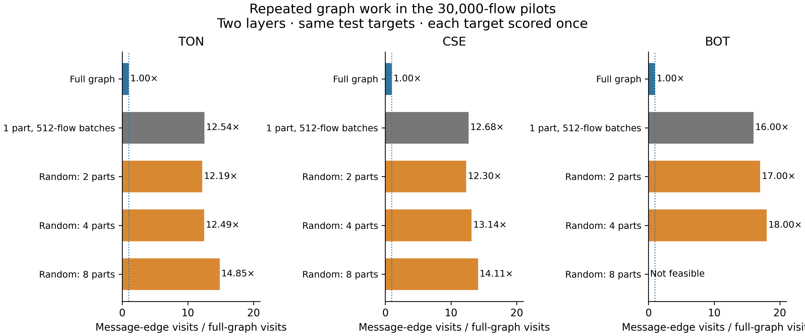

# Graph work and memory checks

The new profile counts how often graph data is used across batches. It does not train a model, select settings, or compute classification scores. It uses the saved test graphs from the 30,000-flow pilots and checks their frozen row-ID hashes.

## Results

The table reports message-edge visits divided by the visits in one full-graph pass. Each original target flow is still scored once. A factor of 12 means repeated context work, not twelve predictions per flow. Each condition uses two message-passing layers.

| Dataset | Full graph | One partition, 512-flow batches | Random 2 | Random 4 | Random 8 |
|---|---:|---:|---:|---:|---:|
| ToN | 1.00 | 12.54 | 12.19 | 12.49 | 14.85 |
| CSE | 1.00 | 12.68 | 12.30 | 13.14 | 14.11 |
| BoT | 1.00 | 16.00 | 17.00 | 18.00 | Not feasible |

The one-partition control shows that much of the repetition already comes from splitting targets into small batches. It would be wrong to attribute the entire extra cost to partitioning. More partitions can add further work, but the current samples do not establish a speed advantage. The BoT test graph has four genuine IP nodes, so eight node partitions remain invalid. Real-data METIS is still unavailable in the local Windows environment and is listed explicitly in each profile manifest.



These counts describe the current exact-context implementation, including its induced context arcs. They are not a universal lower bound for GraphSAGE, a FLOP count, or an estimate of communication across machines. The recorded packing times use a shared process and must not be treated as controlled inference latency. The current profiles read the older NPZ graphs; they do not measure a speed or memory benefit from the new storage format.

## Code changes

New runs save graph arrays as separate NumPy files. Workers open these files in read-only memory-mapped mode. The CSR index is saved too, so each worker can reuse it. Older NPZ graphs still load. Tests confirm that the mapped graph gives exactly the same logits as the original graph and that saved graph directories cannot be overwritten.

The in-memory CSV reader now stops when the source file exceeds the configured `max_input_bytes` limit, which defaults to 512 MiB. This is a file-size check, not an estimate of RAM use. Full-source audits still use the separate streaming script. A larger in-memory run needs a measured scaling check before this limit is increased.

Batch packing also checks `max_batch_tensor_bytes`, which defaults to 256 MiB. The check happens before copying feature rows into the batch or transferring them to a GPU. It preserves exact context and fails when the limit is exceeded. It does not silently drop neighbors or targets. New runs record the effective limits.

These checks do not bound total memory. Graph arrays, temporary index arrays, model activations, gradients, and optimizer state also use memory. Memory mapping allows read-only access without loading another full array copy, but touched pages still occupy RAM. No memory-saving claim follows from the storage change alone.

## Checks and next work

The tests cover a star graph where small batches repeat the entire context, a one-partition control, label-independent work counts, the exact packed-tensor limit, file-size rejection, mapped graph logits, and a full run with fresh workers. The existing correctness tests remain in place.

The [batch-size comparison](BATCH_SIZE_STUDY.md) now includes the measured one-partition baseline and all locally available conditions. Larger pilots should keep batch size separate from partition count, retain the same targets across conditions, and record repeated work, total inference time, and peak memory. Full dataset runs and the multiclass protocol revision remain open.

## Reproduction

```text
python -m ca_edgeids profile --run-dir runs/ton-binary-scaling-30000 --out runs/ton-work-profile
python scripts/report_graph_work.py
```

The reporting script reads the committed aggregate profiles in `artifacts/profiles/` and rebuilds their combined CSV, LaTeX table, and SVG/PDF/300-dpi PNG figure. The aggregate files contain no raw flow records, host addresses, predictions, or checkpoints.
