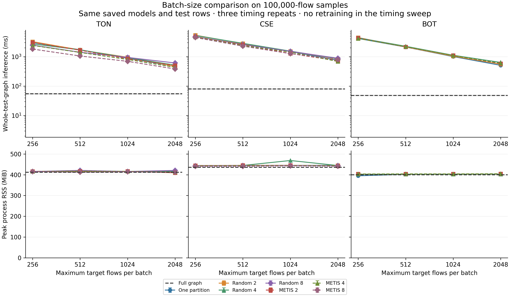
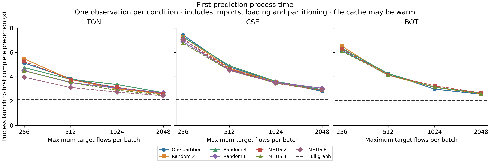
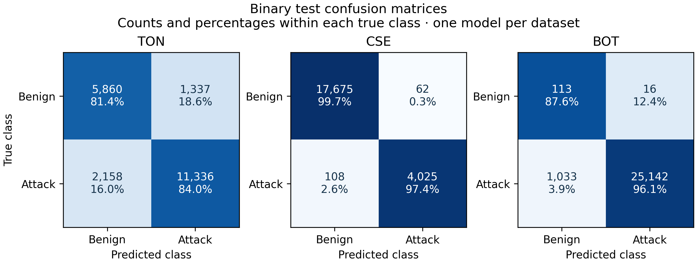

# Linux binary pilot: 100,000 flows per dataset

This pilot checks the larger workload with real METIS, rather than substituting random partitions. Each source sample contains 100,000 flows; the actual number of test flows is determined by the frozen host-pair split and is reported separately. This is one pilot size, not a full scaling curve or a five-seed journal evaluation.

## Frozen protocol

The three official archives were scanned again with the same uniform-priority sampling seed, 2026. Archive and CSV hashes, complete-source class counts, and BagIt checksums agree with the earlier audits. No label-based sampling or split-seed search is used. The plan and sample hashes are fixed in `configs/linux_scaling_100000_plan.json` before model fitting.

The binary models keep the earlier settings: seed 7, split seed 42, 10 selected flow fields, two layers, hidden width 16, dropout 0.2, training batch limit 512, a maximum of 10 epochs, and patience 3. Training uses random source ownership with exact context. Validation macro F1 selects the checkpoint. The models are retrained on the larger training samples, then frozen for all inference conditions. RF/MLP fitting is outside this systems pilot.

All conditions run on the same local Ubuntu environment under WSL2, using CPU PyTorch 2.9.0 and PyMETIS 2025.2.2. The main numerical library versions match the earlier Windows pilots. CPU model, available Linux memory, package versions and source hashes are recorded. Timings must not be compared directly with the earlier Windows measurements as though only workload size changed.

The inference matrix includes one Full pass plus one-partition, Random and METIS conditions at batch limits 256/512/1024/2048 and partition counts 2/4/8. Each condition runs in a fresh process, completes one full warm-up pass, then measures three complete graph predictions. All test targets must be scored once; probabilities must agree with the frozen Full reference within the stated tolerance and class predictions must be identical. Infeasible partitions, timeouts and memory failures remain outcomes.

Warm inference, packing, model forward time, partitioning, graph loading and checkpoint loading are recorded separately. First-prediction process time includes launch through the first complete prediction. It has one observation per condition, not three independent repeats, and does not include source CSV preparation or graph conversion. The operating system's file cache need not be cold. Process RSS is sampled at 5 ms; it excludes the parent process and the host/VM memory footprint.

## Execution

The code passed all 31 tests in the actual Linux environment with METIS installed. The fresh-worker integration check also passed on Windows after adding the first-prediction timings.

Run from the repository root in the prepared Linux environment:

```text
python scripts/run_linux_scaling.py
```

Private run files are written under `runs/linux-scaling-100000/`. Checked aggregate results are published in [the result bundle](../artifacts/linux-scaling-100000/). It includes the frozen plan, requirements, validation histories, full timing records, preparation costs, work counts, confusion matrices and verification report. Raw flows, model checkpoints and per-flow predictions stay local. Generate a new aggregate bundle with `python scripts/report_linux_scaling.py`; existing bundles refuse to overwrite.

## Completed results

The experimental code was frozen at `a390799c32fb53f554649b6ab5b886d3b8d84d2b`. Every training and inference source snapshot matches that commit. The later file-format checks accept Windows/Linux line-ending differences in generated inputs while retaining strict official-archive hashes. The extended 33-test Linux workflow passed at `b5026da`.

There are **79 completed conditions and 237 warm timing measurements**: 29 conditions each for ToN and CSE, and 21 for BoT. Real-data METIS completed in all three datasets, across 32 conditions. Eight BoT conditions are explicitly infeasible: Random/METIS with eight partitions at each batch limit, because its test graph contains only six IP nodes. No condition failed from a timeout or memory error.

Every completed condition scores the same test targets exactly once. Class predictions are identical to Full; the largest absolute probability difference is 5.96e-8. These checks establish scheduling correctness for the saved models, not better classification accuracy from partitioning.

| Dataset | Training flows | Validation flows | Test flows | Test IP nodes | Macro F1 | Weighted F1 | Benign recall | Attack false-positive rate |
|---|---:|---:|---:|---:|---:|---:|---:|---:|
| ToN | 56,312 | 22,997 | 20,691 | 229 | 0.8184 | 0.8330 | 0.8142 | 0.1858 |
| CSE | 56,190 | 21,940 | 21,870 | 3,971 | 0.9873 | 0.9922 | 0.9965 | 0.0035 |
| BoT | 70,619 | 3,077 | 26,304 | 6 | 0.5784 | 0.9756 | 0.8760 | 0.1240 |

The approximate split proportions reflect host-pair grouping. BoT has only 11 Benign validation flows and 129 Benign test flows. Its weighted F1 hides weak minority-class performance; report its macro F1 and per-class precision/recall alongside it. ToN's 18.6% false-positive rate also remains a substantial limitation. These are initial untuned, single-seed models.

Full-graph inference is fastest among every completed condition in each dataset. The table below holds the batch limit at 512 for the batched methods; values are means of three complete warm test-graph predictions in milliseconds.

| Dataset | Full | One partition | Random 2 | Random 4 | Random 8 | METIS 2 | METIS 4 | METIS 8 |
|---|---:|---:|---:|---:|---:|---:|---:|---:|
| ToN | 54.69 | 1718.32 | 1687.16 | 1699.72 | 1411.76 | 1656.76 | 1391.24 | 1053.18 |
| CSE | 79.58 | 2781.11 | 2771.63 | 2837.97 | 2594.54 | 2517.11 | 2402.89 | 2277.18 |
| BoT | 48.28 | 2121.93 | 2135.35 | 2252.85 | Infeasible | 2145.84 | 2184.57 | Infeasible |

Larger batches generally reduce repeated context work. METIS helps some matched batched conditions, but none overtakes Full. For example, ToN with eight partitions and batch limit 512 takes 1.053 s with METIS versus 1.412 s with random ownership, while Full takes 0.055 s. At that batch limit, METIS still traverses about 29.4 times the Full message-edge workload. The one-partition control repeats about 38.9 times, showing that small batches contribute much of the overhead.



Full's sampled peak process RSS is 411.6 MiB for ToN, 435.5 MiB for CSE and 399.9 MiB for BoT. The batched conditions do not demonstrate a consistent process-memory benefit. Packed tensor size and repeated edge traversals are separate quantities; neither should be presented as total memory.

## Timing boundaries and interpretation

Full's process-launch-to-first-prediction observations are 2.157 s, 2.143 s and 2.063 s for ToN, CSE and BoT. Each is one observation, with potentially warm filesystem caches. These include imports, graph/checkpoint loading, setup and the first complete prediction; they exclude source preparation, graph construction and WSL startup. They are not independent cold-start repetitions.

Source-sample reading/preprocessing takes 1.044/1.244/1.136 s for ToN/CSE/BoT; graph construction takes 0.122/0.160/0.090 s. These are separate preparation-stage observations, not an online latency measure. The complete-source audits and sampling scans are also outside the inference timers. Detailed components and timing standard deviations remain in the CSV tables.





## Decision before larger experiments

This pilot does not justify a partitioning speed claim or a final journal result. A 100,000-flow sample can still yield very few IP nodes. Comparing these Linux results to the earlier Windows 30,000-flow runs would confound size with environment and separately trained models. There is no controlled large-topology scaling curve, five-seed quality comparison, multi-worker deployment, causal ground truth or unseen-host result here.

Before committing to full-source repetitions, address repeated exact-context computation and compare any revised inference design with the same Full baseline and test population. Freeze that design before its next test evaluation. Validation-only model selection, equal-budget RF/MLP and graph baselines, training/feature/topology ablations, independent seeds and a documented multiclass protocol remain required. METIS optimizes the simple IP adjacency used here; it need not minimize repeated flow workload or every measured cut-flow fraction. The manuscript should be rewritten from verified outputs after those scientific gates are addressed. Overleaf remains unchanged.

The [subsequent layer-wise comparison](CACHED_INFERENCE.md) now implements and checks an alternative to this repeated context computation, with three independent process blocks. The results above retain the original inference methods and timing records.
