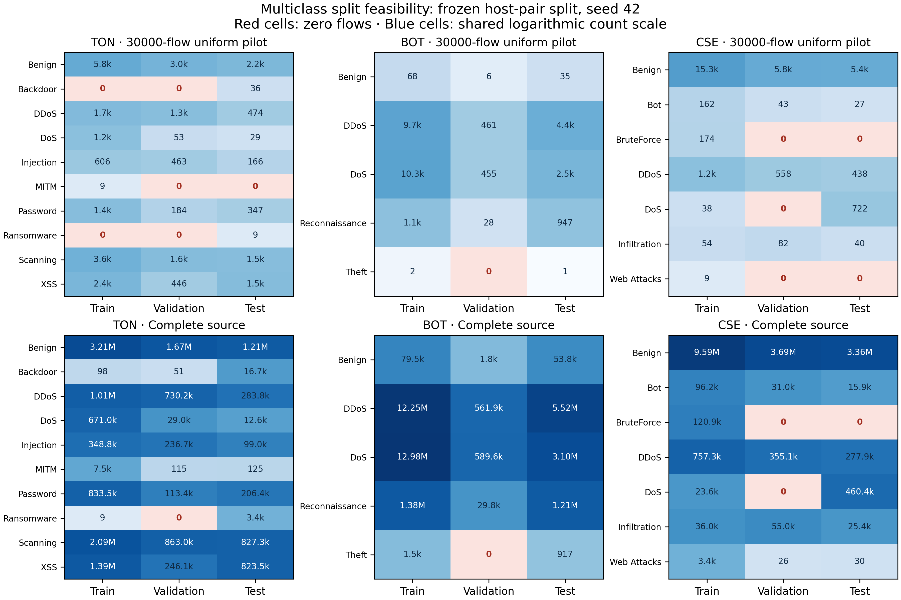

# Multiclass feasibility gate — 19 October 2026

The frozen host-pair split cannot currently support the planned all-class multiclass evaluation. This is a measured dataset/protocol limitation, not a failed model or an accuracy result. No multiclass model was fitted, no split seed was searched, and no class was dropped or merged in response to these checks.

## Evidence

The 30,000-flow uniform samples were inspected first. Each dataset was missing at least one validation class. The complete original archives were then streamed with the same pair grouping, seed 42, and 60/20/20 hash thresholds. Their SHA-256 values match the previously BagIt-verified provenance; all parsed row counts and original-label totals reconcile exactly.

| Dataset | Complete flows checked | Missing training classes | Missing validation classes | Missing test classes |
|---|---:|---|---|---|
| NF-ToN-IoT-v2 | 16,940,496 | None | Ransomware | None |
| NF-BoT-IoT-v2 | 37,763,497 | None | Theft | None |
| NF-CSE-CIC-IDS2018-v2 | 18,893,708 | None | BruteForce, DoS | BruteForce |

ToN Ransomware occupies three host pairs: one training pair (9 flows), zero validation pairs, and two test pairs (3,416 flows). BoT Theft occupies three pairs: two training pairs (1,514 flows), zero validation pairs, and one test pair (917 flows). CSE BruteForce occupies only two pairs in the entire source; no allocation of these two pairs to three disjoint sets can provide this family in all three sets.

The samples also have many shared hosts between splits, despite complete host-pair isolation. This protocol supports a held-out-pair claim, not an unseen-host, unseen-episode, temporal, or topology-adaptation claim. A larger sample alone does not resolve the full-source missing classes.



## Decision for the next experiments

1. Keep the existing split and record these multiclass conditions as infeasible. The new preflight command publishes aggregate class and host-pair counts before any training. Training now rejects absent training classes before graph allocation and retains the existing validation guard.
2. Continue binary scaling pilots where both training and validation have both classes. Keep their settings, split seed, and test population fixed; do not tune using pilot test results.
3. Revise and freeze the multiclass design before any multiclass fitting. Distinguish closed-set classification on known hosts from held-out-pair or unseen-host generalization. Possible secondary within-host/session protocols require genuine grouping metadata and an explicit limited claim. A random flow split cannot be advertised as unseen-topology evidence.
4. Do not silently switch seeds, weaken grouping, invent timestamps, remove the missing families, or change label definitions to produce a full metric table. A revised protocol must explain what population it evaluates and how related traffic is controlled. If suitable episode/time metadata is unavailable, restrict the claim and report that limitation.

The next manuscript and experiment plan must incorporate this gate. The full multiclass, five-seed study is not ready to launch under the original protocol; the earlier 4–6 week estimate remains conditional on resolving experimental design and scaling.

## Reproduction

From the repository root, install the package and run:

```text
python scripts/create_pilot_config.py --dataset ton --rows 30000 --task multiclass
python -m ca_edgeids preflight --config configs/ton_multiclass_pilot.json --out runs/ton-preflight
python scripts/audit_split_feasibility.py <official-archive.zip> --dataset ton --provenance docs/provenance/nf-ton-v2.json --out runs/ton-complete-source.json
```

Repeat for `bot` and `cse`. The full audit retains unique pairs in memory and streams flow rows; CSE has 1,866,048 distinct pairs, so memory still depends on topology. Aggregate JSON/CSV evidence is in `artifacts/preflight/`; no host addresses, raw flows, per-flow predictions, or checkpoints are published there. `scripts/report_split_feasibility.py` regenerates the combined CSV/LaTeX and SVG/PDF/300-dpi PNG figure from the committed aggregate reports.
